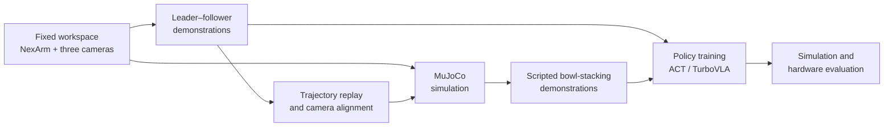

Robot learning depends on more than a model. A camera that shifts between sessions changes the images a policy sees; an arm that responds differently from its simulation changes the actions it needs. At VinUniversity, our team built a workflow around the **Hiwonder NexArm** to make those parts work together.

## A workspace that stays consistent

I designed an aluminum-extrusion gantry to hold the arm bases and cameras in fixed positions. The overhead camera captures the full table, the front camera shows the gripper's approach, and a wrist camera helps when the arm blocks the other views. Keeping those viewpoints stable makes demonstrations easier to compare across sessions and with simulation.



  

    
  

  

    
  

## From human demonstrations to simulation

An operator moves the unpowered leader arm while the powered follower copies the motion. The recording workflow captures the follower's actions and three synchronized RGB views, then combines completed sessions into a local dataset. The RealSense depth stream helps check the camera setup, but it is not part of the policy dataset.

  <video src="/assets/video/teleop-demonstration.mp4" controls width="100%" class="rounded z-depth-1 shadow-sm"></video>
  
Leader–follower teleoperation during data collection.

We also built a MuJoCo scene for a three-bowl stacking task. Recorded joint trajectories help tune the simulated arm's response, while a camera overlay helps align the simulated and physical views. The simulator can then produce scripted demonstrations with varied visual and physical conditions. Its assisted grasping makes those episodes useful for training experiments, but it does not measure real-world grasp success.

## Policy training and evaluation

The project includes an ACT path for learning from camera views and robot state, plus a TurboVLA path that also accepts a task instruction. Real and simulated demonstrations can be used together during training. The diagram shows the intended flow through evaluation; this page does not claim a measured physical success rate for a trained policy.

The work taught us that stable cameras, repeatable demonstrations, and a calibrated simulation are all part of the learning system. The next meaningful result is a controlled hardware evaluation that compares policies trained with real data alone and with a mixture of real and simulated data.



Thanks to our VinUniversity teammates, professors, and lab collaborators for their work on the hardware, workspace, and data collection. The implementation is available in the [NexArm repository](https://github.com/khanhthanhdev/lerobot-nexarm).
