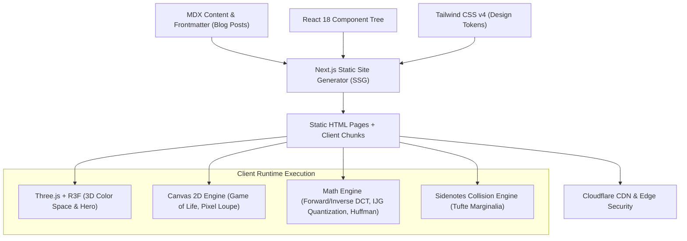

# Technical Architecture & Reverse Engineering Report: Sophie Wang’s Website & Interactive Explanations

> **Target Origins Analyzed:**
>
> - Homepage: `https://www.sophielwang.com/`
> - Interactive Article: `https://www.sophielwang.com/blog/jpeg`
>   **Artifact Type:** Decompiled & Reconstructed Engineering Dossier

---

## 1. High-Level System Architecture



The website is an ultra-fast, statically exported React single-page application built on Next.js. Rather than running a Node.js server, the build generates pre-rendered HTML files (`nextExport: true`, `__N_SSG: true`) that hydrate dynamically on the client. Heavy 3D visualizers, Three.js bundles, and mathematical solvers are code-split into asynchronous dynamic chunks (`ssr: false`) and loaded strictly on-demand.

---

## 2. Comprehensive Inventory of Libraries & Packages

Below is the verified inventory of third-party libraries, engines, and internal modules decompiled from the production bundles:

| Library / Tool           | Version / Signatures Identified                                | Purpose & Location in Application                                                               |
| :----------------------- | :------------------------------------------------------------- | :---------------------------------------------------------------------------------------------- |
| **Next.js**              | `v14.x` / `v13.x` Pages Router (`__NEXT_DATA__`, `nextExport`) | Framework routing, build optimization, SSG generation, image pre-fetching.                      |
| **React & React-DOM**    | `v18.2+` (`framework-92d2fa...js`)                             | Core UI library, state management (`useState`, `useMemo`, `useRef`, `useLayoutEffect`).         |
| **Tailwind CSS**         | `v4.x` (`@supports (color:color-mix...)`, `oklch()`)           | Utility-first styling, responsive grid layouts, design token system.                            |
| **Three.js**             | `r160+` (`fb7d5399.9337d...js`, 680 KB)                        | WebGL 3D rendering for point clouds, perspective cameras, scene lighting, and orbital models.   |
| **`@react-three/fiber`** | `v8.x` (`6321.863ba6...js`)                                    | React declarative renderer for Three.js primitives (`<points>`, `<group>`, `<mesh>`).           |
| **`@react-three/drei`**  | `v9.x` (`OrbitControls`, `Html`, `Billboard`)                  | Camera controls and camera-facing 2D HTML annotations in 3D WebGL space.                        |
| **`next-mdx-remote`**    | `v4.x` (`compiledSource`, `MDXContent`)                        | Compiles and dynamically renders MDX articles containing embedded interactive React components. |
| **KaTeX**                | `v0.16.x` (`katex.css`, `KaTeX_AMS`, `KaTeX_Caligraphic`)      | Fast LaTeX mathematical formula rendering for equations and matrix definitions.                 |
| **Cloudflare Edge**      | CDN-CGI Email Decode, Turnstile / Bot Management               | Obfuscates contact emails (`email-decode.min.js`) and secures static asset delivery.            |

---

## 3. Design System & Typography Engineering

### Typography Stack

Sophie Wang uses a hybrid pairing of academic serif typefaces, an expressive cursive wordmark, and retro monospace/pixel fonts:

| Role                    | Font Family                           | Source                  | Usage                                                                         |
| :---------------------- | :------------------------------------ | :---------------------- | :---------------------------------------------------------------------------- |
| **Brand Wordmark**      | `"beloved-script"`                    | Adobe Typekit           | Hero title (`Sophie Wang.`), playful artistic signature.                      |
| **Academic Body**       | `"ff-seria"`, `"warnock-pro-subhead"` | Adobe Typekit           | Article prose, research descriptions, high-legibility serif text.             |
| **Pixel Art & Loaders** | `"pf-pixelscript"`                    | Adobe Typekit / WebFont | Bitmap typography for Conway's Game of Life text loaders and retro tags.      |
| **Monospace / Links**   | `"degular-mono"`                      | Adobe Typekit / System  | Navigation items, bracketed links (`[Email]`, `[X]`, `[Scholar]`).            |
| **Mathematics**         | `KaTeX_Main`, `KaTeX_Math`            | Bundled WOFF2           | In-line equations ($I: D \subset \mathbb{Z}^2 \to \mathcal{C}$) and matrices. |

### Color Tokens & Tailored Palettes

Tailwind CSS v4 CSS variables are used for light/dark switching and high contrast:

```css
:root {
  /* Core Brand Colors */
  --accent: var(--color-primary-500); /* Ochre / Golden Mustard: #c19233 */
  --accent-hover: var(--color-primary-400); /* Slightly brighter ochre */
  --fg: #000000; /* Deep ink black */
  --bg: #ffffff; /* Pure paper white */
  --muted: var(--color-brand-neutral-500); /* #6b7280 */
  --line: var(--color-brand-neutral-200); /* Hairline borders */
  --tag: var(--color-brand-pink-400); /* Accent highlights */
  --site-content-width: 1024px;
}

/* Dark Mode Tokens */
.dark {
  --bg: var(--color-brand-neutral-950); /* Deep charcoal slate */
  --fg: var(--color-brand-neutral-50); /* Soft off-white */
}

/* Selection Highlight with color-mix */
::selection {
  background: color-mix(in srgb, var(--accent) 25%, transparent);
}
```

### Retro Bevel Buttons

Interactive UI elements throughout the articles (like color space selectors and subsampling ratios) emulate vintage OS interfaces:

```css
.bevel-button {
  border: 1px solid var(--line);
  background: var(--surface);
  font-size: 0.75rem;
  padding: 2px 10px;
  cursor: pointer;
}
.bevel-button-pressed {
  background: var(--accent);
  color: #ffffff;
  border-color: var(--accent);
}
```

---

## 4. Core UI & Frontend Techniques

### A. Dual-Layer Avatar (High-Res $\leftrightarrow$ Pixelated Crossfade)

The portrait on the homepage is an interactive dual-image stack:

1. **Underneath**: `/pc-home.webp` (Smooth high-res hand-drawn digital portrait).
2. **Overlay**: `/pc-pix-home.png` (Exact pixel-art counterpart).

```jsx
<div
  className="relative w-[350px] max-w-full"
  style={{ filter: "drop-shadow(2px 2px 2px rgb(0 0 0 / 0.16))" }}
  onMouseEnter={() => setHover(true)}
  onMouseLeave={() => setHover(false)}
>
  
  
</div>
```

- **Pre-warming**: On `componentDidMount`, a background browser instance triggers `new window.Image().src = "/pc-pix-home.png"` so there is zero latency or flash on initial hover.

---

### B. Conway’s Game of Life Canvas Divider

A canvas banner divider (`<canvas style="image-rendering:pixelated">`) runs a live cellular automaton:

- **Toroidal Space**: Pixels that move off the right border wrap around to the left border; pixels moving off the top wrap to the bottom.
- **Battery & Performance Guards**:
  ```javascript
  // 1. Pause when scrolled out of viewport
  const observer = new IntersectionObserver(([entry]) => {
    isIntersecting = entry.isIntersecting;
    updateAnimationLoop();
  });
  // 2. Pause when browser tab is inactive/minimized
  document.addEventListener("visibilitychange", updateAnimationLoop);
  // 3. Disable if user enabled OS reduced motion
  const reducedMotion = matchMedia("(prefers-reduced-motion: reduce)");
  reducedMotion.addEventListener("change", updateAnimationLoop);
  ```

---

### C. Game of Life Text Loading Component (`life-loader`)

Instead of a generic spinning ring, loading states use a canvas where the word _"Loading..."_ is drawn into an offscreen canvas using the bitmap font `"pf-pixelscript"`.

The script reads the raw pixel buffer via `getImageData(0, 0, w, h).data`. Pixels where alpha $> 80$ are converted into living cells ($1$) in a 2D array. The cellular automaton then runs at $120\text{ ms}$ tick intervals, causing the typography to dissolve and evolve as the widget initializes.

---

## 5. Explorable Explanations Engine (JPEG Compression Post)

Sophie Wang’s [JPEG compression post](https://www.sophielwang.com/blog/jpeg) contains **9 bespoke interactive tools**.

### 1. `JpegPipelineHero` (Continuous 3D Pipeline Stage)

- **Engine**: Three.js, R3F, `@react-three/drei` (`Billboard`, `Html`).
- **Functionality**: A 3D spatial tour through the 11 compression stages:
  $$\text{image} \to \text{rgb} \to \text{ycbcr} \to \text{channels} \to \text{subsample} \to \text{patch} \to \text{dct} \to \text{quant} \to \text{reconstruct} \to \text{entropy} \to \text{jpeg}$$
- **Camera Interpolation**: Uses smooth cubic Hermite polynomial transitions ($3t^2 - 2t^3$) between camera anchor coordinates.

---

### 2. `InterpolatedColorSpacePlot` (Real-Time 3D Color Space Morphing)

- **Engine**: Three.js Point Cloud (`THREE.Points`, `THREE.Float32BufferAttribute`).
- **Data Source**: Fetches 5,500 sampled 3D points from `/images/image_compression/color_space_points.json`.
- **Mathematical Transition**:
  - In **RGB Mode**, vertex coordinates are mapped to $[R, G, B] \in [0, 1]^3$.
  - In **$Y'CbCr$ Mode**, vertex coordinates are transformed to $[C_b, Y', C_r]$.
  - Toggling between bases triggers a $600\text{ ms}$ transition using cubic deceleration:
    $$\vec{P}(t) = \vec{P}_{\text{start}} + (\vec{P}_{\text{end}} - \vec{P}_{\text{start}}) \times \left(1 - (1 - t)^3\right)$$
  - Camera-facing labels for axes ($Y'$, $C_b$, $C_r$, $R$, $G$, $B$) are pinned to 3D positions via `@react-three/drei`'s `Html` wrapper.

---

### 3. `ImageChannelExplorer` (Channel Separation & Raw Footprint)

- **Functionality**: Splits the input image into isolated components:
  - RGB channels: Red, Green, Blue.
  - $Y'CbCr$ channels: $Y'$ (grayscale luminance), $C_b$ (blue-yellow chroma difference), $C_r$ (red-yellow chroma difference).
- **Dynamic Calculation**: Measures image `naturalWidth` $\times$ `naturalHeight` and calculates the uncompressed 24-bit raw byte footprint:
  $$\text{Payload} = \text{Width} \times \text{Height} \times 3 \text{ bytes}$$

---

### 4. `ChromaSubsamplingExplorer` (Interactive Loupe Magnifier)

- **Canvas Magnifier**: As the user hovers over the image, four synchronized $160 \times 80$ canvases extract an $8 \times 4$ pixel region around the cursor.
- **Rendering**: Canvas smoothing is turned off (`ctx.imageSmoothingEnabled = false`), and explicit $1\text{px}$ grid lines (`20 \times a + 0.5`) are drawn over the blown-up pixels.
- **Subsampling Comparison**: Readers inspect how color detail is shared across neighboring pixels in:
  - **4:4:4** ($3.0\text{ bytes/px}$ — full resolution)
  - **4:2:2** ($2.0\text{ bytes/px}$ — horizontal pairs)
  - **4:2:0** ($1.5\text{ bytes/px}$ — $2 \times 2$ pixel quads)
  - **4:1:1** ($1.5\text{ bytes/px}$ — $4 \times 1$ horizontal runs)

---

### 5. `ChromaSamplingGridExplorer` (Discrete Cell Mapping & Inverse Color Recovery)

- **Discrete Mapping**: Uses an 8-cell ($4 \times 2$) block to demonstrate index mapping:
  - $4:4:4$: `[0, 1, 2, 3, 4, 5, 6, 7]`
  - $4:2:2$: `[0, 0, 1, 1, 2, 2, 3, 3]`
  - $4:2:0$: `[0, 0, 1, 1, 0, 0, 1, 1]`
  - $4:1:1$: `[0, 0, 0, 0, 1, 1, 1, 1]`
- **Real-Time Inverse Math**: Reconstructs RGB values for each cell in real time:
  $$
  \begin{aligned}
  R &= \operatorname{clamp}\left(Y' + 1.402 \times (C_r - 128)\right) \\
  G &= \operatorname{clamp}\left(Y' - 0.344136 \times (C_b - 128) - 0.714136 \times (C_r - 128)\right) \\
  B &= \operatorname{clamp}\left(Y' + 1.772 \times (C_b - 128)\right)
  \end{aligned}
  $$

---

### 6. `DctBasisAtlas` (Live Synthesis of 64 2D DCT-II Basis Patches)

- **Mathematical Synthesis**: Rather than loading 64 image assets, the client evaluates the discrete cosine transform basis equation in JavaScript:
  $$B_{u,v}(x, y) = \frac{1}{4} \alpha(u) \alpha(v) \cos\left(\frac{(2x + 1)u\pi}{16}\right) \cos\left(\frac{(2y + 1)v\pi}{16}\right)$$
  $$\alpha(k) = \begin{cases} \frac{1}{\sqrt{2}} & \text{if } k = 0 \\ 1 & \text{if } k > 0 \end{cases}$$
- **UI Atlas**: Arranges the resulting $8 \times 8$ grayscale matrices in a clickable 2D frequency grid ($u$ horizontal, $v$ vertical) with real-time patch magnification.

---

### 7. `DctBlockExplorer` (Forward DCT, Energy Sorting & Inverse IDCT)

- **Interactive Patch Extraction**: Lets the reader click on an image to select any $8 \times 8$ block.
- **Forward DCT**:
  $$C(u, v) = \frac{1}{4} \alpha(u) \alpha(v) \sum_{x=0}^7 \sum_{y=0}^7 (I(x, y) - 128) \cos\left(\frac{(2x+1)u\pi}{16}\right) \cos\left(\frac{(2y+1)v\pi}{16}\right)$$
- **Energy Truncation Slider**: Ranks all 64 coefficients by absolute magnitude $|C(u, v)|$. An interactive slider allows the user to keep the top $k \in [0, 64]$ coefficients while zeroing out the rest.
- **Inverse DCT Reconstruction**: Calculates the reconstructed patch $\hat{I}(x, y)$ in real time to show how natural image energy is concentrated in a tiny fraction of low-frequency coefficients.

---

### 8. `QuantizationExplorer` (IJG Quality Factor Scaling)

- **Standard Table**: Uses the official Independent JPEG Group (IJG) 64-element luminance quantization table $Q_{50}$.
- **Scaling Algorithm**:
  ```javascript
  const S = quality < 50 ? Math.floor(5000 / quality) : 200 - 2 * quality;
  const scaledTable = Q50.map((q) => Math.max(1, Math.min(255, Math.floor((q * S + 50) / 100))));
  ```
- **Live Quantization**: Divides the 64 DCT coefficients by `scaledTable` and rounds:
  $$C_q(u, v) = \operatorname{round}\left(\frac{C(u, v)}{Q_{\text{scaled}}(u, v)}\right)$$
- **Zero-Collapse Counter**: Displays how high-frequency values collapse to $0$ as quality drops from 95 to 10.

---

### 9. `JpegEntropyExplorer` (Zigzag Scan & Huffman Encoding)

- **64-Element Zigzag Traversal Matrix**:
  ```javascript
  const ZIGZAG = [
    0, 1, 8, 16, 9, 2, 3, 10, 17, 24, 32, 25, 18, 11, 4, 5, 12, 19, 26, 33, 40, 48, 41, 34, 27, 20, 13, 6, 7, 14, 21, 28, 35, 42, 49, 56, 57, 50, 43,
    36, 29, 22, 15, 23, 30, 37, 44, 51, 58, 59, 52, 45, 38, 31, 39, 46, 53, 60, 61, 54, 47, 55, 62, 63,
  ];
  ```
- **SVG Path Visualization**: Draws an animated polyline connecting the visited matrix cells as the reader scrubs the step slider.
- **Run-Length & Variable-Length Binary Encoding**:
  - DC difference encoding.
  - AC coefficients encoded as `(run, size)` pairs where `size = floor(log2(|val|)) + 1`.
  - Negative numbers encoded using ones' complement binary format (`((1 << size) - 1 + val).toString(2)`).
  - Appends EOB (`End of Block` symbol `(0, 0)`) when trailing coefficients are zero.

---

## 6. Academic Marginalia & Sidenote Relaxation Engine

Sophie Wang implements Edward Tufte-style margin notes that avoid overlapping on desktop while collapsing into numbered footnotes on mobile.

```
Desktop Layout (>= 1280px)                        Mobile Layout (< 1280px)
┌────────────────────────┐                        ┌────────────────────────┐
│ Prose paragraph text   │   ┌─────────────────┐  │ Prose paragraph text   │
│ with reference [1] ────┼──>│ Sidenote [1]    │  │ with reference [1]     │
│                        │   └─────────────────┘  │                        │
│ Another paragraph text │   ┌─────────────────┐  ├────────────────────────┤
│ with reference [2] ────┼──>│ Sidenote [2]    │  │ Footnotes Section:     │
└────────────────────────┘   │ (auto-relaxed   │  │ [1] Sidenote 1 content │
                             │  downwards)     │  │ [2] Sidenote 2 content │
                             └─────────────────┘  └────────────────────────┘
```

### The Sidenote Relaxation Algorithm

When notes are located close to each other in the prose, simply positioning them at the reference anchor causes vertical overlapping. The site implements a **bidirectional layout pass**:

```javascript
// Forward pass: ensure minimum 12px gap between successive notes
let minTop = -Infinity;
let positioned = notes.map((note, i) => {
  let refEl = document.getElementById(`${note.id}-ref`);
  let idealTop = refEl ? refEl.getBoundingClientRect().top - parentTop : 0;
  if (idealTop < minTop + 12) {
    idealTop = minTop + 12;
  }
  minTop = idealTop + noteHeights[i];
  return { ...note, top: idealTop };
});

// Backward pass: prevent notes from overflowing past the bottom of the article
let maxBottom = parentHeight;
for (let i = positioned.length - 1; i >= 0; i--) {
  if (positioned[i].top + noteHeights[i] > maxBottom) {
    positioned[i].top = Math.max(0, maxBottom - noteHeights[i]);
  }
  maxBottom = positioned[i].top - 12;
}
```

---

## 7. Strategic Recommendations for Your Site

| Goal                         | Path A: Keep & Enhance `al-folio` (Recommended)                                                        | Path B: Build Custom Next.js/Astro Template                                   |
| :--------------------------- | :----------------------------------------------------------------------------------------------------- | :---------------------------------------------------------------------------- |
| **Effort**                   | **Low to Moderate** (Incremental additions).                                                           | **High** (Full rebuild and migration).                                        |
| **Academic Features**        | Keeps Google Scholar sync, BibTeX papers, CV, citations, search, and GitHub Pages CI out of the box.   | Must rebuild BibTeX parsers, citation engines, and CV templates from scratch. |
| **Adding Canvas / Three.js** | Supported immediately via Vanilla JS, HTML5 `<canvas>`, or ES module imports (`https://esm.sh/three`). | First-class React component ecosystem with `@react-three/fiber`.              |
| **Game of Life Divider**     | Can be dropped into `_includes/` as a 40-line Liquid include.                                          | Built as a custom React hook/component.                                       |
| **Sidenotes / Marginalia**   | Add via a lightweight CSS class and ~30 lines of JavaScript.                                           | Implemented via React context and `ResizeObserver`.                           |
